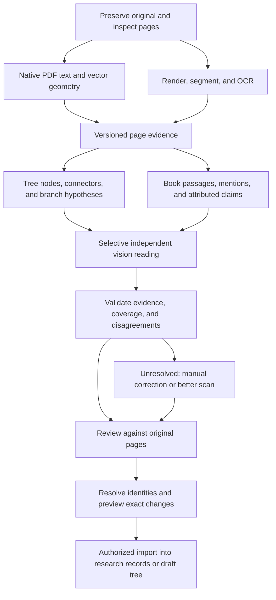

# Reliable Arabic family-tree and lineage-book import

**Status: supervised pilot workflow implemented; accuracy qualification remains open.** Updated
2026-09-28. Arabic family-tree PDFs and lineage books are core sources of platform data,
including documents of poor quality. The current implementation preserves page evidence and
provides separate reviewed workflows for family-chart drafts and book quotations. It is not yet
qualified to claim a particular accuracy level or to auto-import uncertain content.

**Addendum, 2026-10-21:** `docs/import-reading-strategy.md` measures the one document the
repository has, names the binding constraint in this pipeline, gives the published evidence for
why the hosted-vision route produced the numbers it did, and recommends the next increment.
`plans/018-family-tree-import-benchmark.md`,
`plans/019-family-tree-import-name-localisation.md` and
`plans/020-family-tree-import-identity-linking.md` are the three plans that follow from it.
Nothing in this document is superseded; the addendum adds the evidence and the measurement,
and does not change the requirements stated here.

**Recommendation:** build an evidence-preserving import workflow with separate extraction
paths for tree diagrams and books. Combine native PDF extraction, Arabic OCR, selective vision
models, structural checks, and source-linked human review. Benchmark the components on real
documents before selecting providers or making accuracy promises.

The local baseline uses Poppler, native PDF text, Tesseract's Arabic model, and a conservative
local line-candidate detector. It retains independent readings, word coordinates, candidate line
geometry, and the original PDF. Page evidence is checkpointed before downstream extraction;
partial failures keep completed readings and record remaining pages as not processed. Reviewers
can open every physical page, correct transcription in immutable revisions, prepare a
family-chart draft with occurrence-level name boxes, trace and review edges, require a second
reviewer for unclear connections, and import the reviewed subset into a private draft tree. A
dependency-aware ledger supports safe retraction. Line candidates and OCR proximity never create
relationships automatically.

For books and manuscripts, a reviewer can select an exact span from a saved transcription,
review bounded local suggestions for passages with lineage terms, record mentions, relation,
attribution, negation, certainty, and printed page label, edit the staged assertion, and review it
into a source statement grounded in that exact page revision. Suggestions contain no inferred
people or relationships, and reviewed assertions do not create canonical genealogy. Versioned
OCR reruns and candidate extraction from an exact saved transcription are available.
The Jasser chart is authorized for an experimental hosted vision run under the Jasser-only
privacy policy. The experimental reader is DeepSeek V4.1 Flash (`deepseek-flash`) through inline
image requests, with per-unit opaque `user_id` values for the provider's documented KV-cache
isolation and strict local schema validation. DeepSeek's automatic disk context cache is retained
for hours to days; the isolation value limits the cache scope but does not disable retention. No
image is uploaded through the Files API. The first run used a generic `user` field instead of
DeepSeek's documented `user_id`; it was stopped after 14 calls. The corrected v6 run used
`user_id`, but after 25 provider calls it remained partial/manual-required: only two name-region
proposals were produced, with no branch or connector proposals; 20 of 24 tile/subtile units failed
from invalid or truncated output. The v7 smaller-crop run was stopped after 15 calls with only two
name-region proposals, no branches, eight invalid tile outputs, and 31 pending units. It did not
complete page coverage. Pipeline v8 kept the 512-pixel crops, disabled reasoning for the bounded
schema-only calls, and recorded sanitized validation categories without logging output text. It
finished after 139 provider calls with `partial/manual_required`: 39 localized name regions (14
readable, nine partial, 16 unreadable), 21 connector paths, and no branch proposals. Of 127 tile
and subtile units, 38 subtiles failed; four of 15 reading batches also failed. The 39 detections
are far below the chart's expected 500-plus visible names, so the result shows severe omissions,
not a measured recall score. None of these runs is importable or accuracy evidence. No accuracy or
cost claim is supported. Hosted processing is disabled for every other private document.

## 1. What reliability means for Dawha

| Question | Example failure | Required evidence |
| --- | --- | --- |
| Did we read the text correctly? | سعد becomes سعيد | Original crop and transcription alternatives |
| Did we recover the structure? | A correctly read name is attached to the wrong father | Connector path, label, or explicit passage |
| Did we interpret the assertion correctly? | “قيل إنه ابن…” becomes an unqualified assertion | Exact wording, attribution, and uncertainty |
| Did we identify the right person? | Two people named محمد بن عبد الله are merged | Separate mentions and an explicit identity decision |
| Is the source historically supported? | An accurately copied chart contains an error | Source assessment, corroboration, and competing claims |

Success at one layer does not prove success at the next. The importer's first responsibility
is to represent **what this source says**, including its omissions and disagreements.
Historical acceptance remains the platform's research workflow.

Reliability also means visible incompleteness: unreadable names, untraced connectors, skipped
pages, unresolved identities, and unprocessed sections. Empty extraction must never imply
that a page contains no relevant information.

Missing image information cannot be guaranteed recoverable. A blurred dot may distinguish
names; a broken connector may distinguish entire branches. More model calls can generate
plausible guesses without adding evidence. Supported outcomes must include partial import,
manual transcription, and requesting a better original.

## 2. Repository baseline

| Component | Existing foundation | Gap |
| --- | --- | --- |
| `services/core-api/internal/sourceprocessing/upload.go` | Text/JSON/XML plus PDF upload and signature check | No image formats; PDF processing depends on local Poppler/Tesseract in the worker |
| `services/core-api/internal/sourceprocessing/pdf_extractor.go`, `line_detector.go`, `chart_analysis.go`, `chart_vision_client.go` | Native PDF/Tesseract evidence plus Jasser-only experimental vision, source-resolution 240-DPI overlapping PDF crops, coverage ledger, branch/name review, resumable units, per-call/per-run request and output-token ceilings, and one subdivision on dense/truncated tiles | Vision results remain experimental; reviewer confirmation is required; no benchmark-based provider selection |
| `services/core-api/internal/sourceprocessing/types.go`, `page_reviews.go`, `reprocess.go` | Page readings, normalized geometry, immutable human transcription revisions, versioned 300/400-DPI document runs, and single-page extraction from an exact reviewed revision | No independent vision reader or benchmark-based reading selection |
| `db/migrations/0012_source_processing.sql`, `0043_source_page_evidence.sql`–`0049_chart_subtile_units.sql` | Page readings/reviews, versioned runs, chart drafts/import evidence, analysis/branch/name/connector records, checkpoints, and staged book assertions | Independent gold review, measured held-out accuracy, and chart-class qualification remain open |
| `services/core-api/internal/sourceprocessing/tree_drafts.go` | Occurrence-level chart drafts scoped to a processing run, reviewed name regions/edges, private draft-tree import and reversible ledger | No automatic edge interpretation, canonical identity match, or publication |
| `services/core-api/internal/sourceprocessing/book_assertions.go`, `apps/web/src/lib/book-quote-suggestions.ts` | Exact quote spans, mention-level assertion staging, polarity/attribution/certainty, reviewed source statements, and bounded local suggestions for lineage passages | Suggestions do not identify people or infer relations; no model-generated assertions or canonical identity assignment |
| `services/ai-research/app/main.py`, `chart_vision.py` | Typed extraction/resolution interfaces and isolated structured-output DeepSeek chart adapter | DeepSeek is experimental for the exact authorized Jasser source; no measured suitability or class qualification |
| `db/migrations/0003_research_and_jobs.sql`, `0046_source_tree_imports.sql` | Sources, statements, page evidence, draft assertion and tree-import provenance | Staged mentions remain unresolved until the existing research/identity workflow reviews them |
| Existing leases, permissions, identity resolution, tree versions | Concurrency and review boundaries | Chart draft import is integrated; identity resolution and historical acceptance remain separate research decisions |

The text extractor's 200 limit counts returned segments, not necessarily physical PDF pages.
The PDF path separately caps physical pages at 200, upload size at 128 MiB (raised from 25 MiB
on 2026-10-22 when a real 58 MB family chart was refused — the constant's comment carries the
measured reason), text at 200,000
characters/page, stored reading text at 1 MiB/page and 128 MiB/document, OCR runtime at 30
minutes/document, and word regions at 100,000/document. A page with more than 1,000 local line
candidates is visibly marked incomplete in tree review; those segments remain bounded and are
never treated as a complete connector map. Phase 14's text path remains available alongside the
new PDF path.

## 3. Research findings and solution shortlist

The 2025 **KITAB-Bench** evaluates Arabic OCR and document understanding across multiple
source types. Its tested vision models improved character recognition relative to several
traditional OCR systems, but structural conversion remained difficult. This justifies testing
vision alongside OCR; it does not establish accuracy on our diagrams or rank today's providers.
KITAB-Bench is distinct from the historical-text KITAB/OpenITI project.
[Paper](https://aclanthology.org/2025.findings-acl.1135/).

KITAB's historical-text workflow uses **Kraken**, records segmentation/transcription model
versions, and supports correction in **eScriptorium** with images and ALTO XML. The project
explicitly describes continued manual correction. This is a useful workflow precedent, not a
recommendation to copy its older published model configuration unchanged.
[KITAB OCR workflow](https://kitab-project.org/corpus/ocr).

Medical-pedigree digitization research separates text, symbols, and connecting lines before
reconstructing relationships. This supports a modular approach, but those diagram conventions
are different from Arabic family charts and its results are not our benchmark.
[Pedigree digitization study](https://www.mdpi.com/2079-3197/12/3/47).

Capabilities below were checked on 2026-09-27. Documented support is not proven suitability.
Pin evaluated versions and recheck availability at implementation.

| Candidate | Role and rationale | What must be qualified |
| --- | --- | --- |
| Native PDF extraction with `pdfplumber` | First path for digital PDFs; exposes characters and vector lines/curves | Arabic glyph mappings, reading order, outlined fonts, and bad hidden OCR layers. [Documentation](https://github.com/jsvine/pdfplumber) |
| Google Document AI Enterprise OCR | Hosted baseline; Arabic support, layout, native PDF parsing, quality diagnostics | Exact processor version, names, degradation, geometry, and region. Printed Arabic support does not prove historical handwriting quality. [OCR](https://docs.cloud.google.com/document-ai/docs/enterprise-document-ocr), [language matrix](https://docs.cloud.google.com/document-ai/docs/processors-list) |
| Azure Document Intelligence Read/Layout | Competing hosted baseline; separate printed/handwritten and model/version language matrices | Selected API version/region and actual document quality. [Language support](https://learn.microsoft.com/en-us/azure/ai-services/document-intelligence/language-support/ocr?view=doc-intel-4.0.0) |
| PaddleOCR with an explicit Arabic model | Self-hosted baseline/independent reader; PP-OCRv5 documents an Arabic recognizer and polygon/score outputs | Default recognizer is not necessarily Arabic; test the pinned Arabic model and newer challengers separately. [Documentation](https://www.paddleocr.ai/main/en/version3.x/algorithm/PP-OCRv5/PP-OCRv5_multi_languages.html) |
| Mistral OCR | Document-parsing challenger, especially books; OCR 4.0 documents paragraph boxes and structural labels | Arabic quality and coordinate granularity; paragraph boxes may be too coarse for tree nodes. [Model documentation](https://docs.mistral.ai/models/ocr-4-0) |
| DeepSeek V4.1 Flash vision | Current Jasser-only hosted reader; inline original-detail images, JSON output, and strict local schema validation | Automatic disk context caching may retain prefixes for hours to days; documented `user_id` isolation scopes cache use but does not establish chart accuracy. [Model and pricing catalog](https://api-docs.deepseek.com/quick_start/pricing/), [vision guide](https://api-docs.deepseek.com/guides/vision/), [cache behavior](https://api-docs.deepseek.com/guides/kv_cache/), [cache isolation](https://api-docs.deepseek.com/quick_start/rate_limit/) |
| Gemini vision | Potential hosted comparison reader; visual PDF understanding | Crops and branch context: documented PDF resizing can lose small text on large sheets. [Document processing](https://ai.google.dev/gemini-api/docs/document-processing) |
| Qwen3-VL family | Self-hosted visual challenger with documented OCR/spatial capabilities | Model size, hardware cost, and Arabic results; general model claims do not validate genealogy. [Model card](https://huggingface.co/Qwen/Qwen3-VL-32B-Instruct) |
| Kraken with eScriptorium | Specialist historical-print/handwriting route; trainable recognition and correction workflow | Suitable segmentation/transcription models and possibly collection-specific training. [Kraken](https://kraken.re/main/index.html), [KITAB](https://kitab-project.org/corpus/ocr) |

Amazon Textract is not a primary candidate: its documented language list does not include
Arabic. Do not select it merely because infrastructure uses AWS.
[AWS FAQ](https://aws.amazon.com/textract/faqs/).

**Initial comparison:** Google, Azure, and Arabic PaddleOCR on the same authorized corpus;
Gemini and a suitably sized Qwen3-VL model as visual challengers. Add Mistral to the book/layout
comparison and Kraken when historical print or handwriting is represented. This is a bounded
experiment, not a proposal to call every provider on every page in production. If cloud use is
disallowed, compare native extraction, PaddleOCR, Qwen, and Kraken first. Winners may differ
by source class; no production vendor is selected yet.

## 4. Shared workflow

### In-app pilot flow

For a family chart, open **Sources**, create a source with type **Family document**, and upload
the PDF. When processing finishes, open the page evidence to compare the original against OCR,
then choose **Prepare a tree draft from this file**. In the draft, confirm each included name,
draw a connector path for each relationship, select its direction/type, and request a second
review for unclear links. Save the review before importing. **Create private tree draft** writes an
unpublished, reversible tree version; the dialog then provides **Open private tree**.

For a lineage book, create a **Book** or **Manuscript** source. Review and save a page transcription,
select an exact quote span, and enter the people, relationship, attribution, and uncertainty shown
by the text. Reviewing the staged assertion creates cited source evidence; it does not add people
or relationships to a canonical tree.

### Intake and routing

1. Preserve original bytes/checksum; capture source owner/type, title, edition/volume, visibility,
   and permitted processing route. Route per page/region: books can contain diagrams and charts
   can contain prose. Allow user correction of classification.
2. Inspect signatures, encryption, page count/dimensions, embedded text, and raster content.
   Reject unsupported/encrypted inputs clearly or request an unlocked copy. Render in an
   isolated worker with pixel, memory, runtime, and decompression bounds.
3. Distinguish native, scanned, and mixed pages. Embedded text may be bad prior OCR: compare
   samples against the rendered page. Never blindly reverse Arabic strings to repair display
   order; preserve logical Unicode order and coordinate mapping.
4. Estimate blur, clipping, skew, contrast, bleed-through, text size, and handwriting presence.
   These route work; they do not measure genealogical correctness.
5. Inspect long books before processing; support selected volumes/page ranges and a cost
   estimate. Record exclusions. Full-book ingestion must be resumable and incremental.

### Poor-quality material

Use reversible derivatives: orientation/deskew, conservative contrast adjustment, and dewarping
where useful. Keep raw color/grayscale plus optional thresholded variants. Aggressive denoising
can erase Arabic dots or thin connectors. Do not remove lines from the only analysis image.

Trial 300–400 DPI rendering for scanned printed text when source resolution supports it.
This is a benchmark starting point, not a way to restore absent detail. Render large vector
charts directly into tiles. Use overlapping reading tiles, an overview for layout, and wider
branch crops for connections. Preserve transforms to original coordinates, including any
non-linear dewarping map. Deduplicate overlaps by occurrence geometry, not equal names.

Generative image restoration is not authoritative evidence: it can invent letters or lines.
If evaluated, display it only as a labeled aid beside the original; it cannot independently
justify a name or relationship.

Bound escalation: native/original → useful preprocessing variant → independent reader/vision
→ human or better scan. Unreadable content is not a transient API failure. Manual readings
also retain their author and source-image evidence.

## 5. Tree-diagram extraction

### Separate reading, connections, and interpretation

**Nodes:** detect name regions/boxes, transcribe labels, identify legends and repeated headers,
and preserve separate occurrences of equal names. A region may denote a person, couple,
family/branch, or annotation; not every text box is a person.

**Connections:** prefer PDF vector paths where available. For scans, evaluate line/curve
detection, skeleton tracing, junction detection, and endpoint association. Mask text only on
separate analysis images. Distinguish node borders from connectors and crossings from junctions.
Broken lines, colored branches, marriage bars, arrows, and fan layouts need explicit handling.
Connections occluded by text can remain uncertain.

**Interpretation:** establish conventions from legends, labels, and reviewed examples.
Top-to-bottom placement and proximity alone do not prove parenthood. Preserve unknown direction
or type. A lineage link can mean descendant-of across omitted generations; do not force it into
immediate father-of.

**Stitching:** reconcile tiles and page continuations through geometry, continuation labels,
and branch context. A repeated ancestor is a possible same-person link, not automatic
canonical deduplication. Preserve all source occurrences after resolution.

**Vision:** inspect branch-sized crops with an overview and stable region IDs. Request visible
readings separately from connector hypotheses. Output endpoint IDs, direction/type or unknown,
evidence region/path IDs, and alternatives. An unrestricted “complete this family tree” response
is not the production contract. Vision coordinates are hypotheses too: validate bounds and
transforms, then inspect whether the cited pixels actually support the assertion.

### Structural checks

- Every proposed endpoint references an existing detected/reviewed node, with inspectable
  connector or textual evidence. Nearest-neighbor geometry can propose, not establish, kinship.
- Flag self-parenting, reversed direction, duplicates, and directed ancestry cycles in the
  proposed draft. Do not impose a strict tree: repeated ancestors and intermarriage can occur.
- Preserve incompatible parent assertions as review conflicts. Existing database content must
  not silently overrule what another source says.
- Use chronology as a warning when dates, calendars, and generations are uncertain.
- Track orphan nodes, unfinished connectors, and region coverage. No detected line does not
  establish absence of kinship.
- Do not invent unnamed parents or infer a mother from adjacency/marriage bars without supported
  conventions. A fathers-only chart does not assert that mothers are unknown.

Keep unsupported semantics in staging. Extending the platform's predicate vocabulary requires
schema/API design; do not map a broad descendant assertion to `father_of` because the existing
identity vocabulary lacks the intended relation.

## 6. Lineage-book extraction

Books require a passage-and-claim workflow. OCR makes text searchable; it does not resolve genealogy.

1. Preserve edition, volume, PDF page index, printed page label, headings, body, footnotes,
   marginalia, and diagrams. Printed labels may repeat or be missing. Citations must resolve
   to the exact scan, not only a title.
2. Segment by layout and meaningful passages; retain adjacent context for name chains, pronouns,
   and cross-page statements. Deduplicate overlapping extraction by spans and mention IDs.
3. Extract subject mention, predicate, object mention/literal, exact quote, evidence spans,
   attribution, negation, uncertainty, date/calendar, and unresolved references.
4. Distinguish direct assertions, quotations of earlier authorities, editorial corrections,
   alternative accounts, and indexes. Index names point to passages; they do not establish kinship.
5. Suggest identity matches using relatives, dates, places, names, and context. Preserve ambiguous
   mentions without automatically creating or merging canonical people.
6. Attach corroborating/conflicting evidence. Books copying one earlier work are not automatically
   independent witnesses; use the existing source-dependency model.

| Text/convention | Required treatment |
| --- | --- |
| محمد بن أحمد بن علي | Propose an ordered chain of immediate relations with separate mentions; no global identity decision from names alone |
| خالد وأخوه صالح | Contextual sibling assertion; do not invent a father |
| وقيل إن أباه أحمد | Preserve reported uncertainty and attribution |
| ليس من أبناء خالد | Preserve negation; no positive son-of evidence |
| من ذرية فلان | Descendant assertion with unspecified generation distance |
| بني فلان / آل فلان | Possible group/family, not necessarily an individual |
| أبو عبد الله | Possible kunyah; insufficient evidence of a child named عبد الله |
| له عقب / انقطع عقبه | Preserve wording/context for domain review; do not reduce to a universal assertion about children |

Keep authoritative Arabic transcription separate from normalized search text. Version
normalization and mappings to original spans. Removing diacritics/tatweel may help search;
folding ة/ه, ي/ى, or hamza forms must not rewrite identities. Preserve Arabic-Indic numerals,
date ranges, and Hijri/Gregorian labels. Any conversion is a separate derived value with method.

Check for a trustworthy existing digital transcription before OCRing an entire book. OpenITI
can help discover texts/versions but its documentation notes quality and metadata limitations.
Verify edition alignment, use rights, and page mapping. Another edition may supply additional
evidence; it must not silently overwrite damaged text from this scan.
[OpenITI documentation](https://kitab-project.org/docs/openITI),
[project terms](https://openiti.org/docs/Terms%20of%20Use.html).

## 7. Combining OCR and vision without hiding uncertainty

Preserve independent readings before reconciliation. For selected difficult regions, let a
second reader see the original before the first answer, reducing anchoring. A subsequent
comparison can inspect all readings. Align by regions/spans to find disagreement, omissions,
and incompatible edges. Dictionaries and known names may suggest alternatives but cannot
supply missing letters as visible evidence. Allow partial, unreadable, and alternative outputs.

Keep separate signals for text, layout, relationship interpretation, identity matching, and
source reliability. Vendor scores are not calibrated across engines; model self-confidence
is not measured accuracy. Agreement needs validation on held-out documents. Shared models,
training data, and preprocessing create correlated errors: do not multiply scores or count
repeated prompts as independent votes.

An ensemble earns its complexity only if it reduces material error or review effort versus
the best single pipeline. Compare native-only, OCR-only, vision-only, OCR plus geometry, and
combined workflows. Independently inspect some confident agreements to catch shared failures.
Measure abstention and coverage alongside precision; refusing everything is not success.

Route grounded agreement to ordinary review, ambiguous readings/edges/identities to focused
review, and irrecoverable material to manual/rescan. Initial imports always require explicit
human authorization. Review priority is not permission to accept facts or publish trees.

## 8. Evidence model and implementation boundaries

The current workflow uses a versioned intermediate representation before adapting results to
existing research records. The table distinguishes what is persisted from remaining gaps:

| Record | Minimum contents |
| --- | --- |
| Document and physical page | Source/file IDs and checksum; stable evidence ID, one-based PDF index, dimensions, readings, regions, review revision, private preview route |
| Region/reading | Normalized word boxes and local connector-segment candidates; verbatim text, method/model and raw OCR score retained with page evidence |
| Chart mention/node | Occurrence ID, selected page evidence, text, region, inclusion and reviewer status; no name-based identity merge |
| Book assertion | Exact quote and Unicode code-point span, page-review revision, mention strings, relation, attribution, polarity, certainty and revision history |
| Chart edge/assertion | Explicit reviewer-chosen endpoints/type and traced connector path; distinct reviewer ledger when a second review is required |
| Review revision | Reviewer, exact input revision, append-only page transcription or staged assertion; stale edits are refused |
| Import change set | Private tree/version, source-backed unresolved relations, page evidence, applied IDs and dependency-aware retraction manifest |

Choose canonical page coordinates, e.g. normalized top-left `[0,1]`, and retain exact transforms
from provider/crop coordinates. Text offsets reference an immutable transcription revision,
with an explicit unit such as Unicode code points and half-open ranges. Normalized text, byte
offsets, and browser UTF-16 positions are not interchangeable.

The current candidate schema requires a passage. For diagrams, create a region-backed passage
using actual node labels/annotations and link edge geometry separately. Do not fabricate a
sentence claiming the image explicitly said a model inference. Evidence may span pages/regions.
Book scalar/date assertions may need staged literal values: current `claims` requires entity
endpoints, so literal mapping needs deliberate design.

Remaining implementation and qualification work:

- **Versioned reprocessing is implemented:** PDF files can be rerun at 300 or 400 DPI. A saved,
  latest human transcription can be re-extracted as a separate run tied to its exact page evidence
  and review revision. Duplicate active or successful requests reuse the same run; a failed reviewed-
  text attempt can be retried as a new immutable run from that exact revision. Undecided candidates
  and their source statements from replaced runs are marked superseded, while accepted/rejected
  decisions remain. Dependent interpretation review and cross-page re-extraction remain open.
- Run history records run kind, pipeline configuration, actor, and exact input revision; chart
  analysis has resumable region checkpoints, optimistic review revisions, and a tile/branch
  coverage ledger. Page review, tree-draft import, chart analysis, and book assertion states remain
  separate.
- Go owns permissions, review, transactions, and authoritative writes. PDF rendering/OCR still
  runs in the existing worker process; an isolated, resource-limited document worker is open.
- PostgreSQL jobs and object storage remain in use. Per-page job scheduling should follow measured
  load rather than add another orchestration system now.
- Native PDF text, Arabic Tesseract, local line candidates, and the isolated DeepSeek vision adapter
  are implemented. The adapter is enabled only for the exact Jasser source and has no silent local
  fallback; missing credentials or exhausted request/token budgets leave explicit resumable
  setup/partial states. Pipeline v8 begins with 512-pixel, 25%-overlapping original-PDF crops,
  disables reasoning for the bounded locator/reader calls, and permits one smaller source-resolution
  subdivision after invalid or truncated locator output; unresolved children remain
  failed/manual-required. Safe validation paths and error kinds are surfaced without echoing model
  output values.
- The experimental chart workspace proposes branches, scans the complete source page in overlapping
  tiles, reads localized crops, exposes disagreements and residual coverage, and requires human
  source verification and explicit relationship review. Unqualified machine results cannot enter
  normal drafts or imports. The separate offline labeler supports blind annotations and adjudication;
  no Jasser gold export or hosted-versus-Tesseract report has been produced yet.
- A deterministic book helper suggests quote spans only; reviewers still enter every assertion
  field. Cross-page connector stitching and semantic book assertion extraction remain open.

### Application, reprocessing, and retraction

Idempotency keys include authorized source/workspace, checksum, pipeline version, page/region,
and stage. Offer reuse for duplicate uploads without revealing another user's private document.
Preserve equal-name occurrences. Retain raw results/configurations so old output remains auditable
even when a provider cannot reproduce an earlier model response.

A dry run may persist extraction/review artifacts, but changes no canonical people, claims, or
tree versions. Its manifest lists new people, existing-person links, unresolved claims, optional
draft-tree edits, conflicts, excluded regions, and exact target record/version preconditions.

Application rechecks authorization/versions and commits bounded change sets transactionally.
Large imports can use explicitly previewed batches with durable progress, not a false all-done
status. Each write has retry protection. Lease loss, concurrent review edits, or target changes
must prevent stale results from applying.

A person can approve reviewed items together, but transcription approval, identity confirmation,
and acceptance into a tree remain separate decisions. Extraction approval can create an unresolved
claim; historical acceptance and publication are separate authorized actions.

Undo needs a change ledger and dependency checks. Revert untouched records owned solely by the
import when safe; otherwise retract its evidence or supersede its draft version and show downstream
dependencies. Never delete shared people or later researcher work. Rejected/retracted decisions
remain auditable: rejection prevents unapproved canonical effects, not historical records.

## 9. Review experience

The chart review dialog shows original page images beside occurrence boxes and the draft graph;
reviewers draw or trace connector paths and choose endpoints/types explicitly. The book dialog
shows the original page image beside the exact selected transcription span and assertion fields.
That span is not yet highlighted back on the pixels, and adjacent-page context/footnote capture
is not implemented.

Arabic RTL editing, name text/region correction, manual regions, endpoint/relation edits, and
append-only transcription/assertion revisions are implemented. Reviewers can request a new
candidate run from the exact saved page transcription; prior results remain in history and
undecided proposals are visibly superseded. Explicit name split/join tools, dependent
interpretation revalidation, quote highlighting on page pixels, and cross-page context remain open.

The experimental chart workspace keeps per-branch and overlapping-tile coverage, failed/incomplete
units, disagreements, unreadable labels, and residual-review status visible. Selected/reviewed names
and edges can be imported while other occurrences remain excluded. Cross-page continuation
stitching and evidence-backed completeness certification remain open.

Prioritize impact as well as uncertainty: a root connection can affect hundreds of descendants.
For the pilot, require second review for unclear branch connections and disputed identity matches;
measure whether this improves final quality enough to justify its cost.

## 10. Evaluation before provider selection

### A representative reference corpus

An earlier local smoke run on the supplied one-page Jasser chart retained 1,246 Unicode code
points, 395 word boxes, and 97 name-region groups before reaching the line detector's 1,000-line
cap. These historical counts are not accuracy measurements. The current source-resolution vision
workflow and independent labeler have not yet produced an adjudicated Jasser comparison report.
Every name and connection therefore remains unqualified until reviewers finish the complete chart.

Start with roughly **30–50 distinct family charts** and **200–300 pages from at least 10 book
editions**, if available. These are pilot collection targets, not sufficient samples to certify
rare-error rates. Include complete charts/branches and contiguous passages, not just easy words.

Cover vector PDFs, clean scans, low-resolution copies, huge sheets, rotation, cross-page branches,
repeated names, spouse/parent conventions, damaged lines, historical print, footnotes/columns,
name chains, negation/uncertainty, and genuinely unreadable regions. Handwriting is a separate
stratum. Synthetic degradation supplements real damaged documents; it does not replace them.

Two Arabic-capable annotators independently label transcription, nodes/edges, evidence, and
assertion context; adjudicate with a genealogy/domain reviewer. Allow genuine ambiguity in the
reference. Transcribe visible material before consulting external genealogy; label any outside
correction separately.

Split by family document/template and book/edition, not random pages/crops. Keep duplicate scans,
related editions, and synthetic variants together. Use development data for prompts/calibration
and a locked test set. Count independent documents as well as tokens/edges: errors are clustered.

### Metrics

| Metric | Why it matters |
| --- | --- |
| Character/word error, raw and specified normalized variants | Diagnose reading; score names separately from ordinary prose |
| Exact full-name accuracy and node recall | Detect damaged identities and omitted people |
| Directed, typed edge precision/recall | Penalize wrong parent, direction, or relation despite correct names |
| Correctly named and connected subgraphs | Expose broken branches hidden by aggregate OCR scores |
| Book assertion precision/recall | Score relation, endpoints, attribution, polarity, and uncertainty together |
| Evidence grounding accuracy | Cited pixels/spans must actually support the output |
| Identity-link precision and false merges | Existing-person links need contextual labels, not name similarity |
| Coverage, abstention, omission, unreadable-region handling | Prevent artificial accuracy from skipping difficult content |
| Review time and final residual errors | Compare the assisted workflow to manual import |
| Cost per reviewed correct person/relationship; p50/p95 latency | Measure useful results, not just nominal pages processed |

Match extracted edges against reference occurrence IDs, not repeated name strings. Also evaluate
structure using reference transcription to isolate connection errors. Report per-class and
per-document results, uncertainty intervals, and failure examples. Show coverage/review effort
beside precision.

### Proposed pilot gates, not performance predictions

- **System invariants:** every applied item has resolvable evidence and an authorized reviewed
  revision; no silent merges/publication; all selected pages accounted for; no retry duplication;
  tested retraction preserves unrelated work.
- **Clean printed/vector charts:** initially target ≥98% exact-name accuracy, ≥99% directed/typed
  edge precision, and ≥95% node/edge recall before correction.
- **Printed books:** initially target ≥98% precision and ≥90% recall for complete grounded
  assertions including polarity/attribution, before correction.
- **Poor-quality/handwritten inputs:** report separately. Until qualified, offer assisted/manual
  import for that class with explicit partial output.
- **Reviewed pilot output:** independently audit names and relationships, targeting ≥99.5%
  correctness for each and no known critical errors remaining in released pilot data.
- **Practical value:** aim for ≥50% reduction in median review/import time versus a manual baseline
  without worse final errors, separately for charts and books.

These provisional product targets need agreement and adequate sample sizes before locked testing.
Zero errors in 100 independent items still gives an approximate 95% upper error bound of 3%
(the rule of three); it cannot justify “99.9% accurate.” Use document-level resampling or another
justified cluster-aware analysis on real charts. Small corpora support pilot estimates only.

Maintain regressions for dots, reversed ancestry, false junctions, repeated names, missing pages,
negation, kunyah, and bad hidden text. Add corrections to development data with permission and
keep test data independent. Fine-tune only after failure analysis identifies a recurring,
learnable problem and enough permitted labels exist; compare it against the unfine-tuned baseline.

## 11. Operations, privacy, and cost

Support explicit self-hosted and approved cloud routes. Policy applies to OCR, vision, embeddings,
logs, and derivatives. Local failures must not silently trigger cloud fallback. Record provider,
region, retention/deletion behavior, and permitted data use before enabling a route.

**Decision, 2026-10-21: hosted processing is permitted for these documents.** The product
owner has determined that family-tree and lineage-book documents carry no high-privacy or
sensitive content, and that they may be sent to hosted OCR and vision providers. This is
recorded here so that the route is enabled deliberately and can be audited later, not
inherited by default.

What the decision changes, concretely:

- The experimental reader's hard-coded single-file authorisation
  (`internal/sourceprocessing/chart_analysis.go:29`) becomes a policy rather than a digest.
- The provider, region, retention/deletion behaviour, and permitted data use must still be
  recorded before a route is enabled. The decision permits the route; it does not remove the
  record.
- A local failure must still not silently trigger a cloud fallback.
- The provider is selected by measurement. `docs/import-reading-strategy.md` §1.5 shows the
  local reader cannot read the display face this corpus uses, so a hosted reader is expected to
  be part of the production path for this class, not merely a challenger.

One caveat, stated once rather than repeated: a 1432 AH chart contains grandchildren who are
alive today. Living-person rules under `PRODUCT.md` §43 govern *published* trees, which is a
separate decision from the reading path, but the reading path now handles documents about
living people and that belongs in the record.

Originals, crops, OCR text, names, previews, and downloads inherit source permissions. Recheck at
review/application. Documents and model outputs are untrusted data, not executable instructions.
Keep credentials scoped and contents/names out of routine telemetry.

Checkpoint stages; handle timeouts, 429s, partial pages, truncated output, model changes, and
worker restarts. Bound transient retries; quality failures become manual-required. Split oversized
regions/passages while preserving coverage rather than accepting missing branches or truncated JSON.

Use the best qualified primary path per source class and escalate selectively. Track bills,
GPU utilization, review effort, and quality drift. Test a canary corpus before changing model,
prompt, rendering library, or normalization.

Total cost includes rendering/storage + OCR pages/tiles + vision calls/tokens + retries + review.
Cheap OCR can be expensive if it increases correction time. Report cost per reviewed correct
relationship. Measure sheet tile counts and book review effort before setting a budget; API list
prices alone do not estimate the workflow.

## 12. Implementation sequence

| Stage | Deliverable | Gate |
| --- | --- | --- |
| A. Corpus and evaluation contract | **Harness/schema implemented** in `tools/ocr-eval` and `docs/ocr-benchmark-format.md`; permissioned samples and independent annotations still need collection | Reference quality agreed; intended classes represented or explicitly excluded |
| B. Bounded extraction comparison | **Workflow implemented:** offline blind annotation/adjudication, evaluator, full-page/tiled/reviewer-branch Tesseract baselines, and Jasser-only hosted vision; comparative runs and gold labels are still pending | Measured held-out quality/cost; select primary/fallback only for qualified classes |
| C. Shared document foundation | **Partial:** PDF page/region provenance, bounded previews, local worker limits, permissions, retries, and partial-page evidence are implemented; image upload and isolated worker remain open | Geometry, limits, permissions, retries, partial states pass; text uploads compatible |
| D. Family-tree pilot | **Supervised workflow implemented:** name boxes, local line candidates, traced edge review, private draft import, independent second review, and retraction | Representative charts pass quality and operational gates |
| E. Printed-book pilot | **Human-structured evidence workflow implemented:** exact reviewed transcription spans become cited assertions/source statements; automated layout/assertion extraction and cross-page context remain open | Held-out assertions/citations pass and review effort is acceptable |
| F. Hard-document expansion | Historical/handwriting models, additional conventions, optional fine-tuning remain open | Each additional class qualifies independently; no “all Arabic PDFs” claim |

D and E share evidence, review, and application but require distinct extraction/evaluation.
Design the book evidence contract early so chart work does not assume one file equals one tree.
Prioritize printed family PDFs unless representative inputs reveal a more useful first release.

Integration verification must cover real PostgreSQL transactions and lease loss; repeated upload,
reprocessing/application; visibility revocation; coordinate transforms/RTL editing; stale review
revisions; partial failures; human corrections surviving reruns; and retraction after later edits.
Use the repository's implementation verification gates plus separate document benchmarks.
Passing unit/API/browser tests does not establish OCR accuracy.

**Next deliverable: complete blind Jasser annotation and adjudication, run the local/hosted
comparisons, then add three to five independently annotated charts held out by document.** The
analysis and annotation tools are implemented, but no gold corpus or comparative scores exist.
Hosted vision is authorized only for the exact Jasser PDF. Provider winners, supported chart
classes, throughput, review staffing, and budget require that evidence. Automatic connector
reconstruction, cross-page correction propagation, and semantic book assertion extraction remain
open.

Open inputs are qualified Arabic/domain reviewers, additional permissioned held-out charts, and
expected processing volumes. The local DeepSeek key is configured in macOS Keychain for the
Jasser-only run. Reviewer availability is unknown; the first Jasser run stopped after 14 calls
while the provider-specific cache isolation and output-limit contract were corrected. The v6 run
yielded two name-region proposals and no branches or connectors. The v7 run yielded two proposals
before it was stopped. The v8 run reached 39 name regions but still missed most of the expected
chart content and proposed no branches. No gold annotation exists. OCR confidence and model
agreement are not a reliability claim; the 99% precision and 95% recall gates remain unmeasured and
qualification is pending.

## 13. Where the reading strategy now points

Added 2026-10-21. The full argument, with the published measurements behind it, is in
`docs/import-reading-strategy.md`. Three points belong here because they change how §5 and §10
should be read.

**The connector path has a capacity ceiling that the target documents exceed — and the
documents are not the shape this section assumes.** The local line detector truncates at
`MaxLineCandidates = 1000`
(`internal/sourceprocessing/line_detector.go:12`), and the segments are sorted by position
before truncation (`internal/sourceprocessing/line_detector.go:46-51`, `:52`). This is why the
smoke run in §10 reached the cap. The truncation is surfaced only downstream, as
`LineCandidatesTruncated`
(`internal/sourceprocessing/tree_drafts.go:237`), so a reviewer sees a page that is quietly
missing geometry.

Measured on the one chart the repository has, this is worse than a ceiling. It is a
**spatially destructive** truncation, and the document is not a box-and-line diagram at all.
The full measurement is in `docs/import-reading-strategy.md` §1; the three facts that change
the architecture:

- **The Jasser chart is a decorative painted tree**, with names in black Arabic on coloured
  fruit and leaf shapes. It has **no text layer** (0 fonts) and **no vector paths**. There are
  no name boxes and no connector lines; the genealogy is carried by painted foliage.
- **The ink-run detector finds the landscape.** At 300 DPI it finds 9,345 candidate segments
  and keeps 1,000 — discarding **89.3 %**, with **zero** survivors in the right three-quarters
  of the page below the top quarter. The median candidate is 54 px, a letter stroke. Raising
  the render DPI makes it worse (85.9 % discarded at 240 DPI, 91.7 % at 400), because the
  minimum run length scales with resolution while the cap does not.
- **Tesseract cannot read the names.** A tight, legible 600 DPI crop of one large black-on-green
  name returns `2`, and after masking and local binarisation returns `!`: the decorative
  display face fuses the letters, which is outside Tesseract's Naskh training distribution.
  This is a font problem, and no published benchmark contains it.

**§5's "prefer PDF vector paths where available" is a real gap, but it is not the main event
for this document class.** The pipeline rasterises with `pdftoppm`
(`internal/sourceprocessing/pdf_extractor.go:415`) and recovers geometry by thresholding the
pixels (`pdf_extractor.go:433` → `line_detector.go:22`). No PDF vector content is read anywhere
in `internal/` or `cmd/`. That matters for a *digitally authored box-and-line* chart, where
the exact geometry is present in the file and is being re-derived from a picture of it — and
it does not help a pictorial chart at all.

**The hosted-vision result is a category result, not a prompt result.** 39 detections against
500-plus names, and no branch proposals, is what the measurement literature predicts for a
generative reader asked to *find* names on a large dense sheet: classical CV reaches 98.8 %
node F1 and 66.7 % edge F1, against 34.0 % and 10.7 % for the best vision-language model. The
fix is not a better model and not more tiles; it is changing the question from *find* to
*transcribe*. Colour segmentation localises ~404 name carriers on this chart at 600 DPI, 82 %
of them carrying a name — so the remaining task is one isolated word per call, which is where
a vision model is strong.

The four plans that follow are `plans/018-family-tree-import-benchmark.md` (the corpus, the
document-class classification, and the measurements the harness in `tools/ocr-eval` has never
been given — **no answer key is required**, because the corpus is for building the review
screen and the reviewer's own corrections become the key),
`plans/019-family-tree-import-name-localisation.md` (a name-carrier localiser in place of the
ink-run detector, and a per-crop transcription arm),
`plans/020-family-tree-import-identity-linking.md` (identity resolution and entry into the
research graph), and `plans/021-family-tree-import-suggestion-review.md` (the machine's
suggestions in the normal review screen, which is the feature itself).

**Addendum, 2026-10-22 — the corpus has grown past the planning assumption.** Four more family
charts are ingested (البليهي، الفراج، السكران، آل مقبل — three new families), plus a 356-page
genealogical reference book. The chart class that plan 018's "document-class classification"
step was to determine turned out to have **five members**, not one or two: painted fruit,
drawn leaves, a printed oval canopy, a calligraphic tree with names written along the branches,
and a desert tree with a tabular list. The full table of measured name-group counts and reader
probes is §1.8 of `docs/import-reading-strategy.md`; the short version is that the reader
transcribed real names from every class between 96 and 300 ppi while the localiser's colour
assumptions hold on only two classes. The 58 MB chart (آل مقبل) that exceeded the old 25 MiB
upload limit is accepted since 2026-10-22, when the bound was raised to 128 MiB.
`TestValidateUploadInputAcceptsARealFamilyChart` pins the exact real size. The reference book carries a *working* OCR
text layer whose entries are already kinship-structured, which moves the book track from OCR
toward structured extraction (§8).

**Status note, 2026-10-22 — plan 020 is implemented (uncommitted).** The import now links an
occurrence whose normalised name matches an existing person instead of duplicating them
(preview-gated, one occurrence per person per import), proposes never merges for near names
(`entity_resolution_candidates` inside the import's own run), writes `entity_relationships`
and `source_statements` (`extraction_method='imported'`) for every reviewed representable
edge, keeps the verbatim page spelling as a `source_spelling` alias beside the canonical name,
and has a dry run the apply must carry back or refuse. Retraction reverses the graph rows it
wrote and refuses to touch anything a later researcher changed. §6.6 of
`docs/import-reading-strategy.md` records the shapes; nine acceptance tests pin them.

**Status note, 2026-10-22 — raster images are a source format (uncommitted).** The upload
contract now accepts JPEG, PNG and GIF (128 MiB, 40 megapixels of source) and the worker treats
a raster as a one-page document: the same bounded render feeds Tesseract, the line detector and
the page review, previews and page evidence work, and suggestions and tree drafts accept the
file. (The plan 021 suggestion reader no longer crops names from that bounded render; it reads
them from source-resolution tiles — see the note below.) This is the answer to the "website" input: `https://www.obaikan.net/ALALSHEEKH.htm` is a
FrontPage page whose entire body is one 1,962×2,919 GIF, so there is no HTML tree to parse —
the website is an image with a URL in front of it. The آل الصباح PDF (one vector page, no text
layer, no embedded image) is the same reading problem as an exported image. The ink half of the
localiser now runs even when a page has no coloured shape: an early return was the only colour
dependency, and it is gone (`colour-text-anchor-v1+ink-name-groups-v1`). The name-level paired
check is implemented (`CompareCarrierTexts`, `cmd/ocr-eval --compare`) and its first run on the
Jasser renderings paired zero names because the crops are letter fragments at the current render
resolution — a proposal-granularity finding, recorded in §1.9 of the strategy document, not a
claim of accuracy. Upload and extraction are pinned by
`TestValidateUploadInputAcceptsRasterCharts`, `TestImageExtractionProducesOneReviewablePage`
and `TestUploadProcessAndReviewAnImageSource`. The three charts supplied as chat images
(العجلان والعيب، أسرة الحيان، عبد الرحمن سعد الشرمي) are accessioned as PNG documents as well;
at screenshot resolution their name crops are unreadable, which is recorded in §1.9 as a
source-resolution finding rather than a parser failure.

**Status note, 2026-10-22 — names are read at source resolution, and the limit moved to the
reader (uncommitted).** `ReadSuggestions` no longer crops names from a 2,400-px preview. It
opens the page at 240 DPI, renders it in 1,920-px tiles with a 256-px overlap, runs the
localiser on each tile, and assigns each name to one tile by its centre; the name is then read
from that tile. A raster page larger than the old 16-megapixel analysis cap is now accepted up
to the source bound (40 megapixels), because refusing it after a successful upload looked like
a chart with no names. The reading model string is
`colour-text-anchor-v1+ink-name-groups-v1+source-tiles-v1`, and
`TestPlanNameReadingTilesPartitionsThePage`,
`TestReadNamesOnPageReadsEachNameOnceFromSourceTiles` and
`TestOpenChartPageAcceptsAnImageAboveThePreviewBound` pin the parts that can be pinned without
the private corpus.

The result is a clean localisation on the boxed آل الصباح chart: 54 tiles, 3,014 proposed
names (against 2,259 at the old preview) with a median height of 36 px, instead of 18×7 px
crops. It is not a clean reading. A crop that a person
reads as `أحمد` was returned as `معصرة` at 240 DPI, `معمول` at 480, `معصم` at 600 and `معصرة`
at 900; the whole box at 1,200 DPI came back `حماة`, and a synthetic `محمد` in Geeza Pro was
read correctly. The model can read Arabic; it cannot read this chart's calligraphic letterforms.
Tesseract read the same box correctly from one 8× crop and returned nothing or `معمل` from
others. This is plan 019's STOP condition, recorded rather than engineered around: the class
needs manual transcription or a better original, and the review queue is the product. Painted
and leaf charts still fragment; on آل مقبل a larger grouping gap merges branches rather than
forming names. The read result now reports the median name height in source pixels and warns
below 18 px (the three chat images measure 3, 11 and 5 px; آل الصباح measures 36 px), so a
screenshot that was accepted at upload is not silently presented as a reading failure. The measurements are in §1.10 of `docs/import-reading-strategy.md`.

### Addendum, 2026-10-23 — the suggestion review bench

The suggestion review is now a separate, full-screen bench opened from source processing, and
it is deliberately built around the source rather than around the reader's output. It renders
the active name's tight crop and a wider context crop from the original through
`GET /api/v1/source-tree-suggestions/{id}/crop`, keeps the reader's reading and its stored
alternatives visible, and records the reviewer's decision in the existing append-only decision
log. A dedicated `POST /api/v1/source-tree-suggestions/{id}/candidates` endpoint can ask the
vision model for at most eight spelling candidates for that same tight crop, on demand; it
persists nothing and never accepts or writes a name. The crop and context views are capped at
1,600 px/2.5 MP, and the read itself is still the source-resolution tiled pipeline.

This does not change the central rule. The model's text, its alternatives, and its candidates
are hypotheses; the reviewer's action is the only acceptance. The bench reports the unchanged
reading rate with its decision count and refuses to present a rate too early. For the
calligraphic آل الصباح chart and the three low-resolution chat images, the honest supported
outcome remains manual transcription from the best available source crop, with the machine
reading preserved beside it. Automatic identity matching and relationship review remain open
parts of plan 021. The detailed measurements are in `docs/import-reading-strategy.md` §1.10 and
its 2026-10-23 status note.

### Addendum, 2026-10-26 — candidate evidence and a default-off judge

Plan 022's first delivery makes the candidate list measurable without changing who decides.
The decision ledger now carries the candidate snapshot, the selected candidate, input method,
normalizer/pool versions, duration, and an empty judge-output slot in the same transaction as
the decision. Migration `0053_source_tree_suggestion_decision_context.sql` is additive, and the
server validates bounds, positions, sources, and selections; an old client still writes the
legacy defaults. If the server rejects malformed evidence, the web client retries once without
it and tells the reviewer that the decision was saved but the measurement was not.

`make name-eval` is a read-only report over those decisions. It computes candidate recall@8,
recall among any shown candidate, the no-candidate and all-wrong rates, top-1/top-3/MRR, typed
rate, median time to decision, candidate-source coverage, breakdowns by file class, resolution,
page, reader confidence and date, judge abstention split by truth presence, judge versus
deterministic top-1/top-3, a paired bootstrap interval, calibration buckets, and the
300-decision gate. It separates missing snapshots and snapshots produced by a different
normalizer. It does not read source files, call a model, or print candidate or file names. The
local database has an eight-name shadow pilot in one class, below the rate floor, so no rate can
be quoted.

A bounded judge adapter, core client, config endpoint, shadow sampling, separate active row,
and optional tight-crop image path are implemented. The default provider is a local Liquid
`d1:3b` model served by Ollama at `/v1/systemone`; `.env.example` enables active mode for that
local model, where the row is an opinion only and cannot accept, prefill, or reorder a name.
`NAME_JUDGE_IMAGES=false` remains the default. The privacy decision is recorded in
[`docs/name-judge-privacy-and-evaluation.md`](name-judge-privacy-and-evaluation.md), but the
300-decision shadow run has not happened, so no quality or adoption claim exists. The source
crop and manual transcription remain the supported path when the reader and the candidate pool
both miss.
